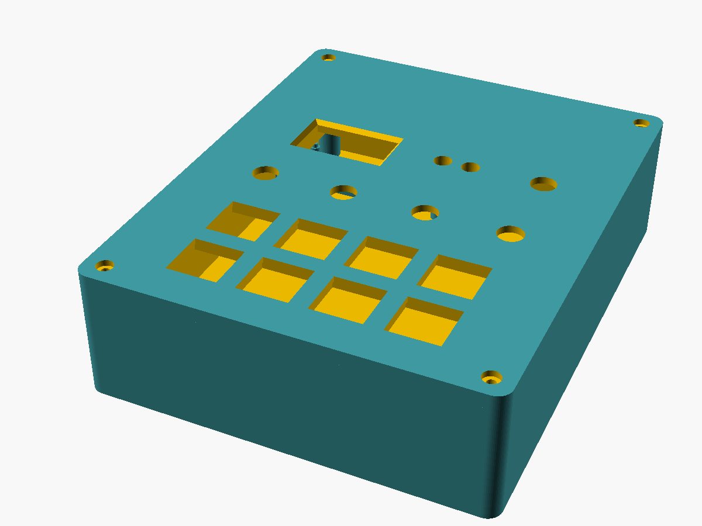
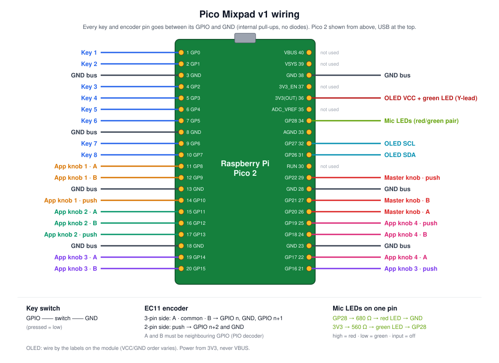
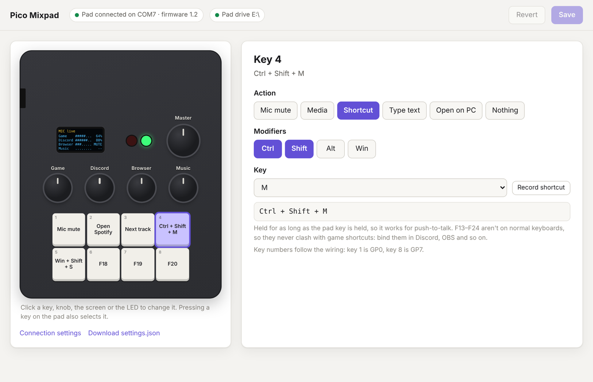

# Pico Mixpad

[](https://github.com/JackVermaak/pico-mixpad/actions/workflows/tests.yml)
[](https://github.com/JackVermaak/pico-mixpad/releases/latest)
[](LICENSE)

A USB desk controller for Windows audio, built on a Raspberry Pi Pico 2 (RP2350):

- **Master knob**: system volume (push = mute). Works with no software installed.
- **4 app knobs**: per-application volume (push = mute that app), e.g. game / Discord / browser / music.
- **8 mechanical keys**: mic mute toggle, media keys, shortcuts, push-to-talk.
- **0.96″ OLED**: app names, volume bars and a MIC MUTED banner. Dims and sleeps when idle.
- **Red/green LED**: mic muted / live at a glance.
- **Settings page**: a local web app to set what every key, knob and the screen do. No firmware editing.



**Status:** v1 (hand-wired, 3D-printed case) is built and in daily use.

## How it works

```
 keys, knobs ──► Pico 2 (CircuitPython)
                   │  USB composite device
                   ├── HID keyboard + media keys ──► Windows (master volume, shortcuts)
                   └── CDC serial (text protocol) ◄──► macropad_host.py ──► Windows Core Audio
                                                        (per-app volume, mic mute, OLED state)
```

Knobs send **relative steps** (`E 1 -2`), never absolute positions, so the PC is the single
source of truth: changes made in the Windows Volume Mixer never fight the knobs.

## Repository layout

| Path | Contents |
| --- | --- |
| `firmware/` | `boot.py`, `code.py`, `mixpad_settings.py`: CircuitPython 10.x firmware |
| `host/` | Windows host app with the settings web app, config, unit tests, a cross-platform wiring test |
| `case/` | 3D-printed case: parametric OpenSCAD source, STLs, print guide |
| `docs/BUILD.md` | Full build guide: parts, wiring, assembly, firmware, testing |
| `hardware/` | Placeholder for the v2 KiCad PCB |

## Quick start

**No clone needed:** the [latest release](https://github.com/JackVermaak/pico-mixpad/releases/latest) has the firmware, the host app and the print-ready STLs as zip files.

1. Flash CircuitPython 10.x (the "Raspberry Pi Pico 2" build, not Pico 2 W) on the Pico 2, then run `circup install adafruit_hid adafruit_display_text adafruit_displayio_ssd1306`.
2. Copy `firmware/boot.py`, `firmware/code.py` and `firmware/mixpad_settings.py` to `CIRCUITPY`, then unplug and replug.
3. On Windows (Python 3.11+): `cd host`, `python -m pip install -r requirements.txt`, then run `python macropad_host.py --settings`.
   The settings page opens at http://localhost:8765.

The full build, from parts list to testing, is in [docs/BUILD.md](docs/BUILD.md).

## Pin map



| Part | Pins |
| --- | --- |
| Keys 1–8 | GP0–GP7 |
| App knobs 1–4 (A, B, push) | GP8–10, GP11–13, GP14–16, GP17–19 |
| Master knob (A, B, push) | GP20–22 |
| OLED SDA / SCL | GP26 / GP27 |
| Mic LEDs | GP28 |

All inputs switch to GND and use the internal pull-ups. Encoder A/B must be consecutive GPIO (PIO requirement).

The mic LEDs share one pin: GP28 → 680 Ω → red LED → GND, and 3V3 → 560 Ω → green LED → GP28.
High = red (muted), low = green (live), input = both off (PC app offline).
The Pico has a single 3V3 pin, so the green LED and the OLED share it through a Y-splice.

**OLED:** wire by the labels printed on the module. VCC/GND order differs between batches.

## Hardware (v1)

Rough prices from AliExpress-type suppliers in 2026 (USD); local shops cost more.

| Part | Item | Approx. price |
| --- | --- | --- |
| Microcontroller | Raspberry Pi Pico 2 with headers (RPI-PICO2-H) | $7 |
| Encoders | 5× EC11, 5-pin with push switch, 20 detents, ribbed 6 mm shaft | $6 (10-pack with knobs) |
| Display | 0.96″ 128×64 SSD1306 OLED, I²C | $3 |
| Keys | 8× Cherry MX (or compatible), OEM-profile keycaps | $8 |
| Indicator | Red + green low-current LEDs, 680 Ω + 560 Ω resistors | $1 |
| Wiring | Female–female Dupont jumpers, cut and soldered on the component side; nothing soldered to the Pico | $4 |
| Fixings | 8× M2 self-tapping screws, 4 rubber feet, micro-USB data cable | $4 |
| Case | 3D-printed plate + tray, about 135 g of PLA/PETG, see `case/` | $3 |
| | **Total** | **≈ $36** |

The full parts list with quantities and the tools needed is in [docs/BUILD.md](docs/BUILD.md#parts).

## Settings page



The host app serves a settings page on http://localhost:8765 (only reachable from your own PC).
Click a part of the pad to change it:

- **Keys**: mic mute, a media key, a shortcut (with a "record" button), typing a text, opening a
  program/file/URL on the PC, or nothing. Pressing a key on the pad selects it on the page.
- **App knobs**: the name on the screen and the apps each one controls, with the apps currently
  playing audio offered as suggestions. Volume step, direction and clicks-per-step.
- **Master knob**: direction, and what pushing it does (any key action).
- **Screen**: orientation (flip 180°), where the mic line goes, dimming and sleep times, I²C address.
- **Mic LED**: off or blinking while the PC app is not running.
- **Rearrange keys & knobs**: match the page to however your pad is wired, either guided (press each
  key and turn each knob when it lights up) or by swapping them by hand. The screen lists the apps
  in the knobs' left-to-right order.

PC-side settings are saved to `host/config.toml`, which the host app reloads by itself. Pad-side
settings are saved as `settings.json` on the `CIRCUITPY` drive; CircuitPython restarts the
firmware when that file changes, so they apply within a couple of seconds. A missing or broken
`settings.json` falls back to the defaults in `mixpad_settings.py`.

To edit settings without the host app running (or on a Mac), run `python webui.py` in `host/`.

## Serial protocol

ASCII lines ending in `\n`.

| Direction | Message | Meaning |
| --- | --- | --- |
| PC → pad | `?` | handshake request |
| pad → PC | `HELLO MACROPAD <version>` | handshake reply |
| pad → PC | `E <ch> <delta>` | app knob 0–3 turned, positive = clockwise |
| pad → PC | `P <ch>` | app knob 0–3 pushed |
| pad → PC | `M` | mic key pressed |
| pad → PC | `K <id>` | key set to "Open on PC" pressed (`1`–`8`, or `master`) |
| pad → PC | `B <n>` | any button pressed (0–7 keys, 8–11 app knob pushes, 12 master push), for the settings page |
| PC → pad | `V <ch> <vol\|-> <muted> <label>` | channel state, `-` = app not running |
| PC → pad | `MIC <1\|0\|->` | mic muted / live / none |
| PC → pad | `QUIET <1\|0>` | key finder: buttons only report, without acting (switches itself off after 60 s) |

The PC sends the full state every second (heartbeat). The pad shows "PC app offline" after 5 s of silence.

## Testing

```
cd host
python -m pytest
```

The host logic runs against fake serial and audio objects, so the tests pass on any OS without hardware.
They also run on every push with GitHub Actions (with a pyflakes lint of the host and firmware code).

To check the wiring of a finished pad on any computer (macOS, Linux or Windows), run
`python3 host/wiring_test.py`. It stands in for the PC app with four fake channels, so every knob,
the mic key, the OLED and the LED respond.

## Design decisions

- **Composite USB device**: keyboard and media keys need no host software; only per-app features do.
- **Relative encoder steps**: no drift between knob and real volume.
- **Readable text protocol with handshake + heartbeat**: debuggable in any serial terminal, auto-detects the port.
- **Hardware-agnostic host logic**: audio backend and serial link are injected, so they are unit-testable.
- **Two LEDs on one GPIO**: tri-state drive gives red, green and off from a single pin.

## Related

[Pico Latency Tester](https://github.com/JackVermaak/pico-latency-tester): a click-to-photon latency tester built alongside this pad,
used to check that the macropad adds no input lag in games.

## Roadmap

- [x] v1: hand-wired prototype, CircuitPython firmware, Python host app, printed case
- [ ] v2: custom KiCad PCB, hot-swap sockets, case designed around the PCB's STEP model
- [ ] v3: firmware ported to C (Pico SDK + TinyUSB), same protocol

## Licence

MIT
