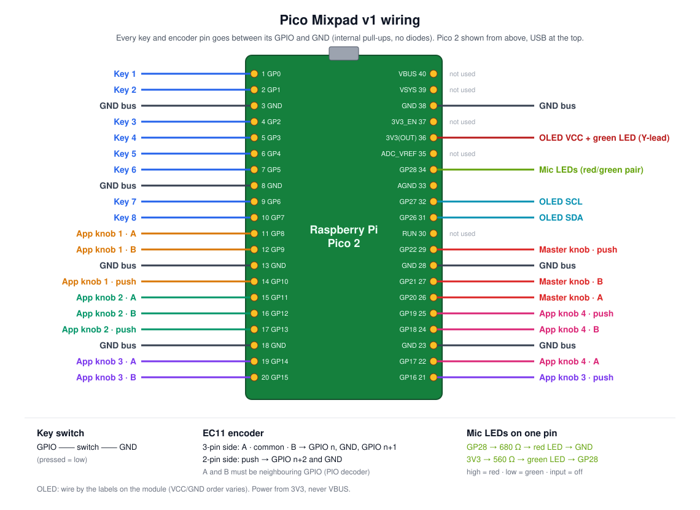
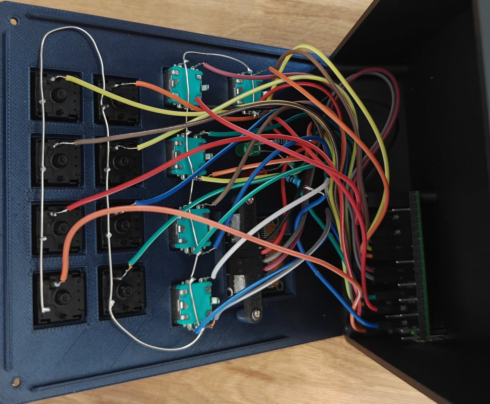

# Build guide (v1, hand-wired)

This builds the Pico Mixpad as a hand-wired pad in a 3D-printed case. Nothing is soldered to the
Pico or the OLED: every part gets a jumper lead soldered to it, and the leads plug onto the Pico's
header pins. That keeps the Pico and screen reusable for the v2 PCB.

## Parts

| Qty | Part | Notes |
| --- | --- | --- |
| 1 | Raspberry Pi Pico 2 **with headers** (RPI-PICO2-H) | The plain Pico 2 build of CircuitPython; a Pico (RP2040) also works |
| 5 | EC11 rotary encoders, 5-pin, with push switch | 20 detents / 20 pulses, M7 bushing; the common 10-packs with knobs are fine |
| 8 | Cherry MX (or compatible) switches | Any type |
| 8 | MX keycaps | OEM / Cherry profile |
| 1 | 0.96″ 128×64 SSD1306 OLED, I²C, 4-pin | Yellow/blue or single colour |
| 1 + 1 | Red and green LEDs, 5 mm (or 3 mm) | Low-current types are brightest at a few mA |
| 1 + 1 | 680 Ω and 560 Ω resistors | Two 1 kΩ also work, slightly dimmer |
| ~31 | Female–female Dupont jumpers, 20 cm | Two 40-packs leave plenty spare |
| 1 | Micro-USB **data** cable | Charge-only cables won't enumerate |
| 8 | M2 self-tapping screws: 4× M2×10, 4× M2×6 | |
| 4 | Self-adhesive rubber feet, ≤12.5 mm | Fit the recesses under the tray |
| — | Printed parts: see [case/README.md](../case/README.md) | About 135 g of PLA or PETG |

**Consumables:** solder (0.8 mm flux core), heat-shrink tubing (1.5–3 mm), hot glue, masking tape for labels.

**Tools:** temperature-controlled soldering iron, multimeter with continuity beep, wire stripper
(26–30 AWG), flush cutters, needle-nose pliers (encoder nuts), small Phillips screwdriver.
Helpful: a small file and drill bits to tidy printed holes.

## Pin map



Every switch and encoder pin connects between its GPIO and GND. The Pico's internal pull-ups do the
rest, so there are no matrix diodes or pull-up resistors.

| Part | Signal | Pico pin |
| --- | --- | --- |
| Keys 1–8 | one per key | GP0–GP7 |
| App knob 1 | A / B / push | GP8 / GP9 / GP10 |
| App knob 2 | A / B / push | GP11 / GP12 / GP13 |
| App knob 3 | A / B / push | GP14 / GP15 / GP16 |
| App knob 4 | A / B / push | GP17 / GP18 / GP19 |
| Master knob | A / B / push | GP20 / GP21 / GP22 |
| OLED | SDA / SCL | GP26 / GP27 |
| OLED | VCC / GND | 3V3(OUT) (pin 36) / any GND |
| Mic LEDs | red + green pair | GP28 |

Rules that matter:

- **Each encoder's A and B must be on neighbouring GPIO numbers.** CircuitPython decodes encoders
  with the RP2350's PIO, which needs consecutive pins.
- **EC11 pinout:** the 3-pin side is A, common (middle), B. The 2-pin side is the push switch.
  Common and one push-switch pin go to GND.
- **Power the OLED from 3V3, never VBUS (5 V).** The Pico's GPIO are 3.3 V only.
- **Wire the OLED by the labels printed on the module.** Some batches are VCC-GND-SCL-SDA, others
  GND-VCC-SCL-SDA, and swapping VCC and GND can kill the screen.

### Mic LEDs: two LEDs, one pin

The red and green LEDs face opposite directions on GP28, so one pin shows three states:

- **Red:** GP28 → 680 Ω → red LED long leg; short leg → GND.
- **Green:** 3V3 → 560 Ω → green LED long leg; short leg → GP28.

| GP28 | Red | Green | Meaning |
| --- | --- | --- | --- |
| High | On | Off | Mic muted |
| Low | Off | On | Mic live |
| Input | Off | Off | PC app offline |

The two LEDs in series need more than 3.3 V, so neither lights while the pin is an input.

**Sharing 3V3:** the Pico has only one 3V3 pin, and both the OLED and the green LED need it.
Make a Y-lead: cut the OLED's VCC jumper about 5 cm from its Pico end, then solder both cut ends
and the green LED's resistor wire together under heat shrink. The short end plugs onto pin 36,
the long end onto the OLED's VCC. The OLED draws about 20 mA and the LED about 2 mA; the 3V3
regulator supplies around 300 mA. Don't use VBUS/VSYS for the green LED instead: it would stay
lit when it should be off and push current into GP28.

## Assembly



1. **Flash and test the Pico before soldering anything.** Install CircuitPython (see Firmware
   below) and check that the `CIRCUITPY` drive appears.
2. **Print the parts** (settings and orientation in [case/README.md](../case/README.md)).
   Check the two fit tests first: a switch clicks in firmly, the encoder nut threads on, the LEDs
   push in, an M2 screw bites into the boss, and the OLED sits with its lit area inside the window.
   Holes that come out tight can be opened with a file or drill; otherwise adjust the tolerances
   at the top of `case/mixpad_v1.scad` and re-export.
3. **Mount the parts in the plate.**
   - Switches clip in from the top.
   - Encoders go in from below; washer and nut on top. Snip off the small anti-rotation tab if
     the body won't sit flat.
   - LEDs push in from below until their rim stops them (a dab of glue if loose).
   - The OLED goes glass-first into the pocket under the plate, pins toward the back. Screw the
     clamp bar across it with 2× M2×6, snug but not tight.
4. **Mount the Pico in the tray.** Upside down: chips facing the floor, header pins pointing up.
   The USB end goes onto the two thin pegs, with its socket lined up with the opening in the left
   wall. Screw the far end down with 2× M2×6.
5. **Prepare the jumper leads.** Cut about 3 cm off one end of each jumper. The long piece with its
   female plug becomes a lead to the Pico; the short offcuts become GND bus links. Half-length
   jumpers are too short: the Pico sits at the back, 10–12 cm from the front keys.
6. **Solder the GND bus.** Chain the stripped offcuts from switch to switch, to each encoder's
   common pin and one of its push-switch pins, and to the red LED's short leg. Finish the chain
   with two long leads that plug onto two Pico GND pins.
7. **Wire the signals.** Solder each long lead to a switch pin or an encoder A, B or push pin,
   put heat shrink over the encoder joints (the pins are only 2.5 mm apart), and plug the female
   end onto its Pico pin from the pin map. Connect the OLED with 4 whole jumpers plus the 3V3
   Y-lead, and wire the LED pair with the resistors soldered in line. Use one colour per signal
   type and label each plug with tape.
8. **Check with a multimeter before plugging in.** Continuity from each part to its Pico pin, and
   no continuity between 3V3 and GND.
9. **Install the firmware, test every input** (sections below), then close it up: a little hot glue
   near the solder joints for strain relief and along the rows of jumper plugs so none slip off,
   4× M2×10 to screw the plate onto the tray, feet into the recesses, knobs on.

## Firmware (CircuitPython)

1. Download CircuitPython 10.x for the **Raspberry Pi Pico 2** (not the Pico 2 W) from
   [circuitpython.org](https://circuitpython.org/board/raspberry_pi_pico2/).
2. Hold **BOOTSEL** while plugging in USB, then drag the `.uf2` onto the `RP2350` drive. It
   reboots as `CIRCUITPY`.
3. Install the libraries from your computer:
   ```
   pip install circup
   circup install adafruit_hid adafruit_display_text adafruit_displayio_ssd1306
   ```
4. Copy `firmware/boot.py`, `firmware/code.py` and `firmware/mixpad_settings.py` to the root of
   `CIRCUITPY`, then **unplug and replug**. `boot.py` only runs at power-up; it adds the second
   serial port the PC app uses.
5. The OLED shows "PC app offline" until the host app connects. Errors are printed on the first
   (console) serial port.

### Settings

Everything you'd want to change (what each key does, knob direction, clicks per step, screen
orientation, dimming, I²C address, LED behaviour) is set in the settings page served by the host
app (below), and saved as `settings.json` on `CIRCUITPY`. The firmware restarts by itself when that
file changes. The defaults, and what each value means, are in `firmware/mixpad_settings.py`.

**Screen upside down?** The case mounts the OLED rotated, so the default orientation is 180°.
If your text reads upside down, switch Screen → Orientation in the settings page.

Default keys, 1–8:

1. Mic mute toggle (handled by the PC app)
2. Play / pause
3. Next track
4. F16: bind as push-to-talk in Discord; it's held for as long as you hold the key
5. Win+Shift+S: Windows screenshot tool
6. F18: e.g. bind in SoundSwitch to swap headphones and speakers
7. F19: free
8. F20: free

F13–F24 exist in the USB standard but not on normal keyboards, so they never clash with game or
app shortcuts.

## Windows host app

**Easiest: the Rust app.** Download `pico-mixpad.exe` (Releases page, or build it from `host-rs/`),
put it in its own folder and double-click it. It needs no Python, lives in the notification area
(left-click: settings page, right-click: status and Quit) and keeps `config.toml` next to itself.
Details in [host-rs/README.md](../host-rs/README.md). The Python version below does the same job.

The host app (`host/`) changes per-app volume, mutes apps and the microphone, and sends the state
to the OLED once a second. It uses only public Windows audio APIs through
[pycaw](https://pypi.org/project/pycaw/) and doesn't inject into or hook other processes.

1. Install **Python 3.11 or newer** from python.org (tick "Add python.exe to PATH").
2. From the `host` folder: `python -m pip install -r requirements.txt`
3. Run `python macropad_host.py --settings`. It finds the pad by sending `?` and waiting for
   `HELLO MACROPAD`, and opens the settings page at http://localhost:8765.
4. If the keys or knobs on the page don't match your pad, click **Rearrange keys & knobs** under
   the pad and follow the guided steps (or swap them by hand).
5. In the settings page, click each app knob and pick the apps it controls (apps playing audio
   are suggested; names come from Task Manager → Details, e.g. `cs2.exe`). Two special entries
   exist: "Focused window" and "System sounds". Then set up the keys and press Save.
   Everything on the PC side is stored in `config.toml`, which you can also edit by hand.
6. To start it at login without a window: Win+R → `shell:startup`, and create a shortcut there
   to `pythonw.exe "C:\path\to\host\macropad_host.py"`. Logs go to `macropad_host.log` next to
   the script.

**Mic mute** acts on the Windows default recording device, so it works in every app at once. If
Discord still transmits while muted, set Discord's input device to "Default".

## Testing

**Wiring test (any OS).** `python3 host/wiring_test.py` stands in for the PC app with four fake
channels (needs `pip install pyserial`). Turning and pushing each app knob moves its bar on the
OLED and prints a line; key 1 toggles the LED between red and green. The master knob changes the
computer's own volume. Keys 2–8 send media keys and F-keys: check them in a key-event viewer such
as the [W3C key event viewer](https://w3c.github.io/uievents/tools/key-event-viewer.html).
On a Mac, key 5's Win key arrives as Cmd.

**Full test (Windows):**

- [ ] Each key 1–8 does its job
- [ ] Master knob changes Windows volume, push mutes
- [ ] Host app log shows `connected on COMx`
- [ ] Each app knob changes its app in the Volume Mixer, push mutes it
- [ ] Mic key toggles mute in Sound settings → Input; the OLED shows MIC MUTED and the LED turns red
- [ ] Unplug and replug: the host app reconnects by itself

### Troubleshooting

| Symptom | Likely cause | Fix |
| --- | --- | --- |
| Pad ignores new settings | `mixpad_settings.py` missing on `CIRCUITPY`, or the drive wasn't found | Copy it over; check the "Pad drive" status at the top of the settings page |
| `code.py` error about pins not sequential | An encoder's A and B aren't neighbouring GPIO | Rewire to the pin map |
| Knob needs two clicks per step | Wrong divisor for your encoder | Settings page → any knob → "2 steps per click" |
| Knob turns the wrong way | A and B swapped | Swap the two wires, or tick "Reverse direction" in the settings page |
| Knob jumps or skips | Contact bounce or a loose wire | Reflow the joint |
| One key or knob dead | Bad joint or wrong pin | Continuity from the part to its GPIO, and its GND link |
| OLED blank | Wrong address, SDA/SCL swapped, or VCC/GND swapped | Check the labels; try address 0x3D in the settings page (Screen) |
| Text upside down | Module mounted the other way round | Settings page → Screen → Orientation |
| OLED says "PC app offline" | Host app not running or wrong port | Run it in a console and read the log; set `port` in `config.toml` |
| Only one COM port appears | `boot.py` missing or not reloaded | Copy `boot.py`, then unplug and replug (a soft reboot doesn't rerun it) |
| App knob does nothing | Process name doesn't match | Copy the exact name from Task Manager → Details; the app must have played audio once |
| One LED never lights | LED in backwards | Long leg toward the resistor from GP28 (red) or from 3V3 (green) |
| LEDs glow faintly with the PC app closed | Leakage on the input pin | Settings page → Mic LED → Blink |

## Serial protocol

See the table in the [README](../README.md#serial-protocol). The host logic is covered by unit
tests in `host/tests/` and `host-rs/` that run on any OS with fake serial and audio objects:
`python -m pytest` from the `host` folder, `cargo test` from `host-rs`.
